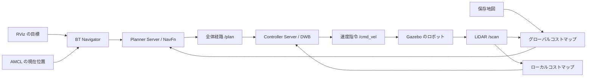

# 12. Nav2 の全体経路と局所制御

確認日: 2026-11-13

## 全体像

保存地図でのナビゲーションでは、AMCL が「今どこにいるか」を推定する。RViz で目的地を指定すると、Nav2 が**全体の経路**を考え、次に**近くの障害物とロボットの動き**を見ながら速度を決める。走行中はセンサー情報を受け取り、必要に応じて経路を更新する。

ここでいう「グローバルプランナー」は目的地までの道筋を決める役、「ローカルプランナー」は Nav2 では主に**コントローラー**と呼ばれ、目の前の状況に応じて速度・旋回を計算する役。車でいえば、前者がカーナビ、後者が運転操作に近い。

## コストマップとは

コストマップは地図の各セルに「通りにくさ」を付けたもの。障害物には高い値、周囲には距離に応じた値が付く。壁や家具の近くを通るより、余裕のある場所を選びやすくする。保存した PGM 地図そのものとは別で、走行中の `/scan` による障害物も反映する。色は RViz の表示設定で変わるので、色の名前だけで意味を決めない。

このフォルダの [Waffle パラメータ](../config/waffle_nav2.yaml) では、ロボット半径を `0.15 m`、障害物周囲のコストを広げる範囲を `0.5 m` に設定している。`0.5 m` 全域が絶対に進入禁止という意味ではない。通れるかどうかはロボットの大きさ、コスト、経路と周囲の障害物で決まる。

## この環境の実際の構成

| 役割 | 実装・設定 | 主な表示・データ |
| --- | --- | --- |
| 全体経路の計算 | `planner_server` の `NavfnPlanner` | RViz **Global Planner** の Path、`/plan` |
| 広域の判断 | グローバルコストマップ。保存地図と `/scan` を統合 | `/global_costmap/costmap` |
| 近くでの走行制御 | `controller_server` の `DWBLocalPlanner` | RViz **Controller** の Local Plan、`/local_plan` |
| 近くの障害物判断 | ロボットと共に動く `3 m × 3 m` のローカルコストマップ | `/local_costmap/costmap` |
| 実際に動かす指令 | コントローラーからの速度指令 | `/cmd_vel` |

通常の単一目標用動作ツリーでは、`ComputePathToPose` を `RateController hz="1.0"` で呼び、**目標へ向かう間の経路再計画を約1 Hzで要求**する。コントローラーの設定は `controller_frequency: 10.0` なので、速度計算の目標周期は **10 Hz**。コストマップの更新設定はグローバル **1 Hz**、ローカル **5 Hz** で、これらは別の周期。負荷の高いシミュレーションでは実際の周期が設定より遅くなる場合がある。

`planner_server.expected_planner_frequency: 10.0` は計画周期の指定ではなく、計画頻度が低いときの**警告基準**。講座の「20 Hz、25 Hz」などは一般的な例で、この Waffle 設定値ではない。また、全体経路は単純に最短距離だけで決まるわけではなく、経路の長さ・障害物周辺のコスト・選んだプランナーの計算方法で決まる。

## RViz で観察する

1. [08. World ナビゲーション手順](08-navigation-world.md)で Gazebo と Nav2 を起動し、**2D Pose Estimate** で現在位置を合わせる。
2. RViz の表示一覧で **Global Planner** と **Controller** を開く。**Global Costmap**／**Local Costmap** と **Path**／**Local Plan** を個別に切り替える。
3. 走行可能な場所に **Nav2 Goal** を置く。全体経路が目標まで伸びること、ローカルコストマップがロボットの周囲を移動すること、青い Local Plan が近くで変化することを見る。
4. [10. 動的障害物の実習](10-dynamic-obstacles.md)の箱を追加すると、センサーで検出した障害物がコストマップに入る。別の道があれば経路を変更し得る。

前の World 実習では `NavigateToPose` で短距離到達を確認済み。今回の章ではローカル設定と Nav2 公式資料を照合した。RViz の線の動きの新たな実測はまだ行っていない。

## 参照

- [Nav2 Jazzy Navigation Servers](https://docs.nav2.org/jazzy/getting_started/navigation_concepts/navigation_servers/)
- [Nav2 Jazzy Planner Server](https://docs.nav2.org/jazzy/configuration_and_development/configuration_guide/core_servers/configuring_planner_server/)
- [Nav2 Jazzy Controller Server](https://docs.nav2.org/jazzy/configuration_and_development/configuration_guide/core_servers/controller_server/)
- [Nav2 Jazzy Inflation Layer](https://docs.nav2.org/jazzy/configuration_and_development/configuration_guide/core_servers/costmap_2d/costmap_plugins/inflation/)
