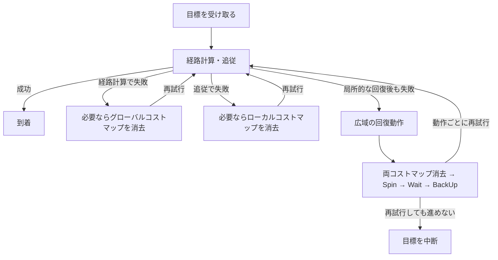

# 14. 目標に進めないときの回復動作

確認日: 2026-11-13

## 何をしているか

Nav2 は目的地までの経路を計算し、コントローラーがロボットを動かす。経路が作れない、または経路に沿って進めないときは、**回復動作**を試してから再計画・再走行する。車で道をふさがれたときに周囲を見直したり、少し下がったりして別の通り方を探すイメージ。ただし、壁の中など到達できない目標を必ず達成できるわけではない。

このフォルダの [Waffle 設定](../config/waffle_nav2.yaml) は、単一目標に Jazzy 同梱の `navigate_to_pose_w_replanning_and_recovery.xml` を使う。回復動作の**順番と再試行**は主にこの動作ツリー（Behavior Tree / BT）が決め、`behavior_server` はそのうち **Spin・Wait・BackUp** などを実行する。コストマップ消去は BT からコストマップのサービスを呼ぶため、すべてが `behavior_server` の処理というわけではない。

## この環境の既定の順序

実際の BT は失敗の種類を `WouldAPlannerRecoveryHelp` / `WouldAControllerRecoveryHelp` で判定する。回復が役立たないエラーでは、図の動作をすべて行うとは限らない。単一目標の BT では、経路計算・追従ごとの局所的な回復はそれぞれ `number_of_retries="1"`、外側は `number_of_retries="6"`。これは無限に動き続けないための上限で、必ず 6 回旋回するという意味ではない。

| 回復動作 | この BT での値 | ねらい |
| --- | --- | --- |
| 両コストマップを消去 | ローカル → グローバル | 古い障害物情報を消してセンサーから作り直す |
| `Spin` | `1.57 rad`（約 90°） | 向きを変え、周囲を再観測する |
| `Wait` | `5.0 s` | 動く障害物が去るのを待つ |
| `BackUp` | `0.30 m`、`0.15 m/s` | 少し後退して進路を作り直す |

順番は BT の `RoundRobin` に書かれている。各動作の後でナビゲーションを再試行し、なお失敗すると次の回復動作へ進む。新しい目標が届けば回復中でも切り替わり得る。後退・旋回は衝突チェックを伴い、動作可能な空間がなければそれ自体も失敗する。

## 講座の動きを安全に観察する

1. [World ナビゲーション手順](08-navigation-world.md)に従い、Gazebo と Nav2 をこのフォルダの設定で起動する。RViz で正しい **2D Pose Estimate** を与える。
2. まず空いた場所に **Nav2 Goal** を置いて、通常の到着を確認する。
3. 次に壁の中など到達不能な場所へ目標を置き、**Nav2 を起動したターミナルのログ**と Gazebo のロボットを観察する。急な後退・旋回に備え、周囲に空間がある状態で試す。
4. `Failed to create a plan`、`Running Spin`、`Running Wait`、`Running BackUp`、最終的な `Goal failed` / `aborted` などを探す。出る順序や一部の動作の有無は、目標位置・地図・その時のセンサー情報で変わる。
5. 動作を止めたい場合は RViz の **Cancel Navigation** を使う。地図や自己位置が乱れた場合は Nav2 と Gazebo を端末で停止し、起動し直して初期位置を与える。

コストマップ消去は**保存済みの PGM/YAML 地図ファイルを削除する操作ではない**。走行中のコスト情報を作り直す操作。未到達の目標が最後に `aborted` となるのは、回復を試しても目的地に到達できなかった結果であり、回復機能が壊れているとは限らない。

## 確認範囲

ローカルのパラメータ、Jazzy にインストールされた BT の XML、Nav2 公式解説を照合した。今回、到達不能目標を Gazebo で新たに実行してログを採取したわけではない。実際の回復動作は次の実習で確認する。

## 参照

- [Nav2 Jazzy: Detailed Behavior Tree Walkthrough](https://docs.nav2.org/jazzy/getting_started/nav2_behavior_trees/detailed_behavior_tree_walkthrough/detailed_behavior_tree_walkthrough/)
- [Nav2 Jazzy: RecoveryNode](https://docs.nav2.org/jazzy/configuration_and_development/configuration_guide/core_servers/bt_plugins/controls/RecoveryNode/)
- [Nav2 Jazzy: Navigation Through Poses Recovery](https://docs.nav2.org/jazzy/getting_started/nav2_behavior_trees/trees/nav_through_poses_recovery/)
