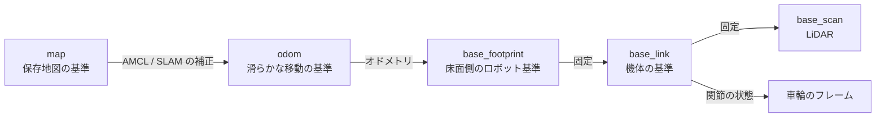

# 15. TF と Nav2 の座標フレーム

確認日: 2026-11-13

## TF とは

TF2 は「ある座標系から見た別の座標系の位置と向き」を、時刻付きで扱う仕組み。Nav2 は地図上のロボット、車輪、LiDAR を同じ座標系で結び、センサーの観測を経路計画や障害物回避に使う。各変換は専用のノードや Gazebo 側のプラグインが配信する。**TF2 を入れれば位置が自動で決まるわけではない。**

この環境の Waffle では、概念上のつながりは次の通り。



講座の `map → odom → base_link` は基本形。この Waffle では `odom` と `base_link` の間に `base_footprint` が入る。TF2 は連続した変換を合成できるので、`map → base_scan` も計算できる。Nav2 の [設定ファイル](../config/waffle_nav2.yaml) では AMCL が `map` / `odom` / `base_footprint` を使い、コストマップと BT Navigator は `base_link` を使う。

| フレーム | 役割 | この構成での供給元 |
| --- | --- | --- |
| `map → odom` | 地図上の自己位置で、オドメトリのずれを補正 | 地図作成中は SLAM、保存地図でのナビゲーション中は AMCL |
| `odom → base_footprint` | 短時間の連続した移動量 | Gazebo の DiffDrive プラグインから ROS 2 にブリッジした TF |
| `base_footprint → base_link` | 床面側の基準と機体の基準を結ぶ | Waffle URDF の固定ジョイント `base_joint`（Z 方向 `0.010 m`）を `robot_state_publisher` が配信 |
| `base_link → base_scan` | 機体に固定した LiDAR の位置 | Waffle URDF の固定ジョイント `scan_joint` を `robot_state_publisher` が配信 |

`base_footprint` は 2D の走行位置を扱いやすくするフレーム。この Waffle の URDF では `base_link` がそこから Z 方向に **1 cm** 上にある。車輪は機体に接続されるが、回転する関節なので常に固定変換ではない。

## `map` と `odom` を分ける理由

- `odom` 基準のロボット位置は連続して動く。車輪などから積み上げた位置なので、時間とともにずれることがある。
- `map` 基準のロボット位置は、LiDAR と地図を照合してずれを直せる。その補正で座標が急に変わることがある。
- `map → odom` は両者をつなぐ補正値。数式では `map → base = (map → odom) × (odom → base)` と合成する。

講座の「ロボット自身は跳ばない」は**物理的な Gazebo のロボット**については正しい。一方、RViz の Fixed Frame が `map` なら、自己位置推定の補正で**ロボットの表示位置が跳ぶことはある**。`odom` 基準の移動が滑らか、という意味で理解する。`map → odom` は物理的な部品間の距離ではなく、二つの座標基準を結ぶ推定値。

## このフォルダで観察する

[World ナビゲーション手順](08-navigation-world.md)で Gazebo と Nav2 を起動し、RViz で正しい **2D Pose Estimate** を与える。別のターミナルで環境を読み込む。

```bash
cd /home/kazuh/project/workspaces/ros2_nav2
source ./setup.bash
ros2 topic list | rg '^/tf(_static)?$'
ros2 topic echo --once /tf
ros2 topic echo --once --qos-durability transient_local /tf_static
```

`/tf` は走行や自己位置推定で変わる変換、`/tf_static` は固定した変換が主。`topic echo` には親フレーム、子フレーム、時刻、平行移動、回転が表示される。時刻はシミュレーション時刻とそろっている必要がある。

数値を一組だけ見たいときは次を実行し、止めるときは **Ctrl+C**。

```bash
ros2 run tf2_ros tf2_echo map odom
ros2 run tf2_ros tf2_echo odom base_footprint
ros2 run tf2_ros tf2_echo base_link base_scan
```

全体の親子関係を PDF にする場合は、**Gazebo と Nav2 が動いている間**に実行する。既定では約 5 秒収集する。出力は Git の追跡対象外の `log/` に置く。

```bash
ros2 run tf2_tools view_frames -o log/tf_frames
```

生成される `log/tf_frames.pdf` を開く。RViz の **TF** 表示ではフレーム名や矢印を表示できる。`map` が出ないときは、Nav2/SLAM が起動済みか、AMCL に初期位置を与えたかを先に確認する。TF を配信するノードが停止している場合も、その変換は表示されない。

## 確認範囲

Jazzy の Nav2 設定、TurtleBot3 Waffle URDF、Gazebo のブリッジ設定、`tf2_tools` と `tf2_ros` の実行可能ファイル、ROS の規約と Nav2 公式資料を照合した。今回、実際の起動中の TF ツリーや PDF は新たに採取していない。

## 参照

- [Nav2 Jazzy: State Estimation](https://docs.nav2.org/jazzy/getting_started/navigation_concepts/state_estimation/)
- [REP 105: Coordinate Frames for Mobile Platforms](https://www.ros.org/reps/rep-0105.html)
- [ROS 2 geometry2: Command-line Tools](https://github.com/ros2/geometry2/blob/rolling/tf2_ros/doc/cli_tools.rst)
