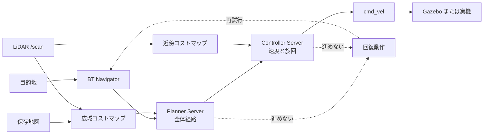

# 16. 講座の3枚の図で見る Nav2

確認日: 2026-11-13

このノートは、講座で提示された「The Nav2 Architecture」「The Nav2 Architecture - Simplified」「Behavior Tree ???」の3枚の図の要点を一つにつないだもの。3枚目は物を探してつかむ**一般的な Behavior Tree の例**で、Nav2 の実際の動作ツリーそのものではない。

## 1枚目：Nav2 の詳しい構成図

目的地や複数の経由点を受け取る **BT Navigator** が中心。BT Navigator は XML で定義された Behavior Tree に従って、**Planner Server** に経路計算、**Controller Server** に走行制御を依頼する。進めないときは回復動作を呼ぶ。Waypoint Follower は複数地点を順に渡す役。

入力となるのは、保存地図、センサー情報、TF による座標関係。Planner が使う広域のコストマップと、Controller が使うロボット周辺のコストマップは別々に更新される。Controller の速度指令 `/cmd_vel` がシミュレーションや実機を動かす。

## 2枚目：走行までの簡略図

全体経路は「どの道を通るか」、Controller は「今どの速さで、どちらへ曲がるか」を決める。回復動作は通常走行のたびに動くのではなく、計画や走行に失敗したときに試す。TF は図の一か所だけに入力する部品ではなく、地図・ロボット・センサーの位置を結ぶために各所で使う。

## 3枚目：Behavior Tree の考え方

画像は「**物の位置を確かめる → 物をつかむ**」という例。黄色の楕円は「もう達成しているか」の確認、緑の四角は実際の行動を示す。

| 図の記号 | 意味 | 画像の例 |
| --- | --- | --- |
| `→` | 左から順に実行する。前が成功したら次へ進む | 位置を確かめてから、つかむ |
| `?` | 左から候補を試し、成功したところで止める | 位置がまだ分からなければ、床・引き出し・クローゼットを順に探す |
| 黄色の楕円 | 条件の確認 | 位置は分かったか／物をつかんだか |
| 緑の四角 | 行動 | 探す／片手または両手でつかむ |

`?` の下に黄色の確認があるので、**すでに条件が満たされていれば探索・把持を繰り返さない**。一つの行動が進行中なら結果が出るまで待ち、成功・失敗に応じて次の枝を選ぶ。Nav2 の BT では同じ仕組みで「経路を作る → 進む」を繰り返し、失敗に応じてコストマップ消去や旋回などを試す。実際の順番は [回復動作のノート](14-nav2-recovery.md)を参照。

## この Jazzy 環境での読み替え

- 1枚目の **Recovery Server** は現在の設定では **Behavior Server**（`behavior_server`）。BT が回復動作を選び、Behavior Server が Spin・Wait・BackUp などを実行する。コストマップ消去は別のサービスを呼ぶ。
- 2枚目は理解用の簡略図で、**BT Navigator と AMCL が省略**されている。目的地は通常、BT Navigator が受け取り、AMCL は保存地図上の自己位置推定に使われる。
- 2枚目では Sensor Data の矢印が一つだが、このフォルダの [Waffle 設定](../config/waffle_nav2.yaml) では **`/scan` を両方のコストマップ**に入力する。
- 1枚目の `/cmd_vel` の型表示は講座の例。この Waffle の Jazzy 設定では `enable_stamped_cmd_vel: true` を使う。概念上はどちらもロボットへの速度指令。

## 一文で覚える

**BT Navigator が手順を決め、Planner が道を作り、Controller が走らせ、失敗したら BT が回復を試す。地図・センサー・TF がその判断を支える。**

関連ノート：[全体経路と局所制御](12-nav2-architecture.md)、[回復動作](14-nav2-recovery.md)、[TF](15-tf-frames.md)。
